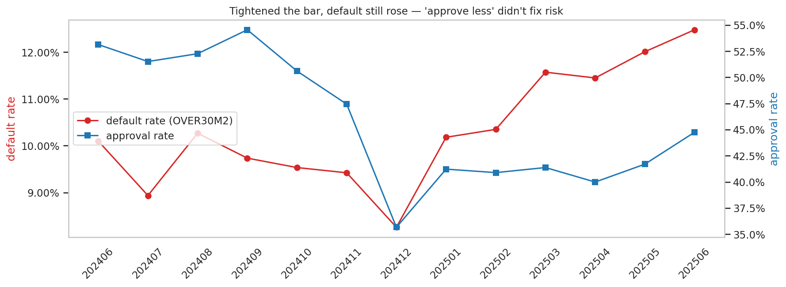
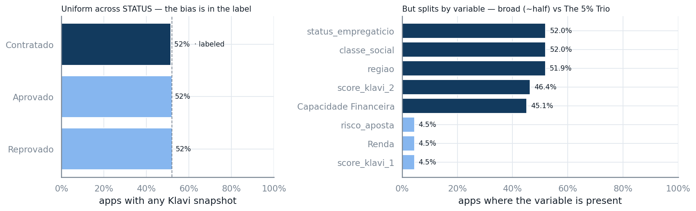
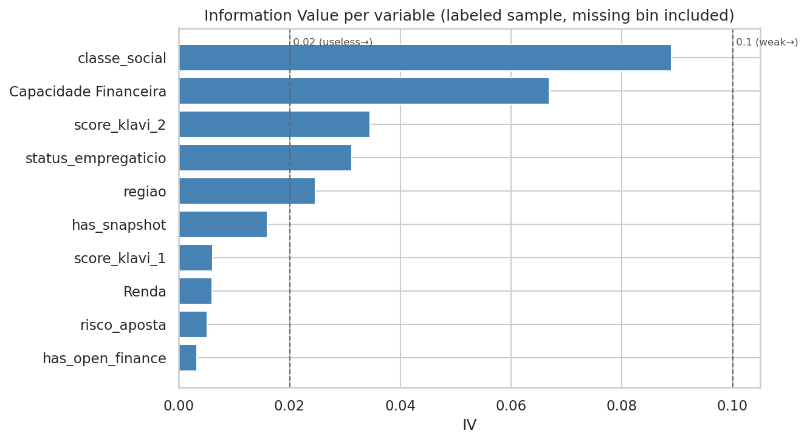
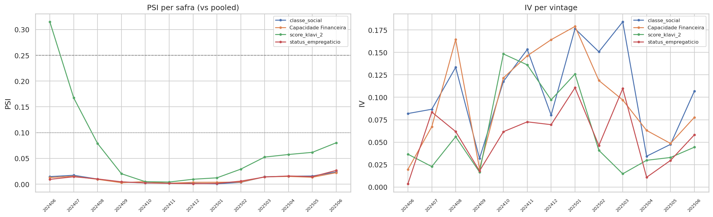
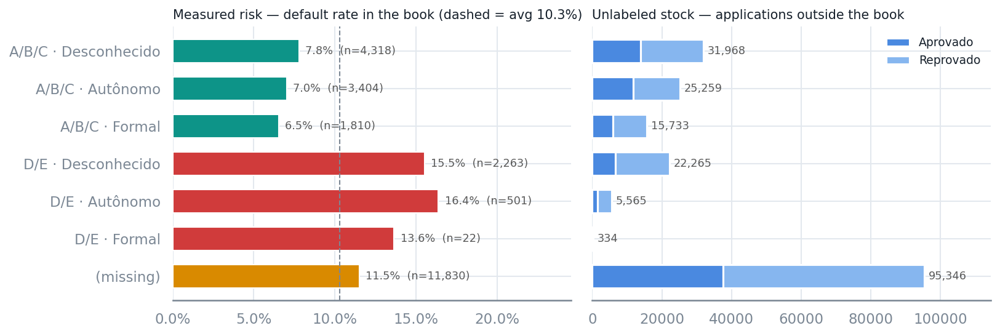
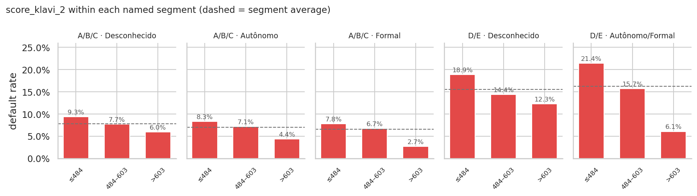
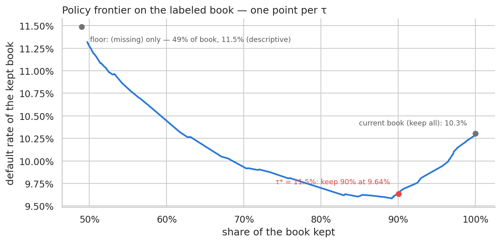
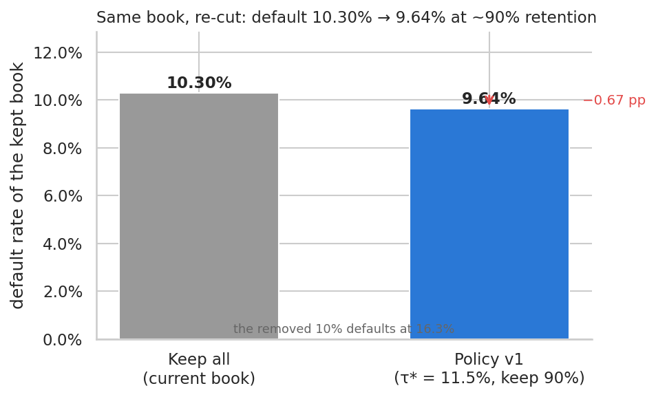
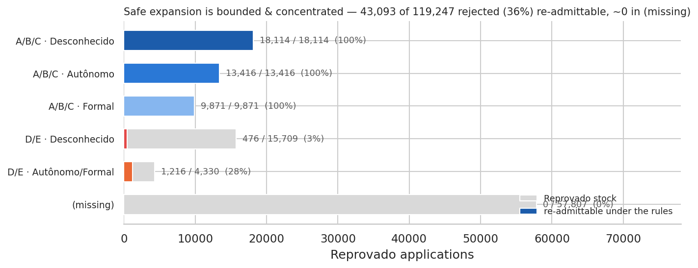

# Credit-Granting Policy Review

*Using open finance bureau variables to improve risk assessment*

Daniel Noce da Silva — Data Scientist · Analysis of client-provided data

**Deliverable:**

- Which variables predict default?
- Which are practical policy candidates
- Example of policy review.

Rendered deck: [PDF](reports/presentation.pdf) · [HTML](reports/presentation.html)

## Why now

> The bar was tightened and default *still* rose — the current process responds by approving less; we propose to **improve how risk is assessed**.

- Default (`OVER30M2`) climbed from ~**8–10%** (2024 cohorts) to **12.5%** (Jun/2025).
- Approval rate fell from ~**54%** to ~**40%** over the same window.
- The two moved the wrong way together: approvals tightened while default rose.

## The data & the catch

> Two raw files reconciled to one row per application — and only a labeled slice has performance (**selection bias**).

- The target `OVER30M2` exists **only for the 24,148 `Contratado`** applications (**10.30%** default).
- A feature snapshot is present at decision time for only **52%** of applications, evenly across `STATUS`. Coverage splits in two: broad variables non-missing ~**46%**, The 5% Trio ~**5%**.

## Q1 — Which variables predict default

> No single variable discriminates strongly — the policy must **combine complementary variables**.

- Ranking: `classe_social` **0.089** > `Capacidade Financeira` **0.067** > `score_open_finance_bureau_2` **0.034** > `status_empregaticio` **0.031** > `regiao` **0.025**.
- The 5% Trio (`score_open_finance_bureau_1` / `Renda` / `risco_aposta`) scores near **0**, driven by **95.5%** missingness.

## Validating the shortlist

> All four candidates pass the redundancy, stability, and fairness checks.

- **Redundancy** — every pair correlates below **|r| 0.5** (max **0.39**, `classe_social` × `Capacidade Financeira`) — none redundant enough to drop. *(A naive **0.73** between those two is a missing-data artifact.)*
- **Stability** — three are steady across **13** vintages (PSI **0.02–0.03**); `score_open_finance_bureau_2` drifts once (PSI **0.31**), its bins coarsened to 3 monotone.
- **Fairness** — `regiao` carries signal but is excluded as a proxy for protected attributes.

## Q3 — A two-tier policy

> Segment by the stable socioeconomic block — then score-cut within each named cell.

- **Tier 1 — Segment** by `classe_social` × `status_empregaticio`.
- **Tier 2 — Score cut** on `score_open_finance_bureau_2` *within* each named cell.
- The named cells fall into three risk tiers: A/B/C **6.5–7.8%** · `(missing)` **11.5%** · D/E **15.5–16.4%** (**2.5×** spread).

## Score orders risk inside a segment

> Every segment hides risk discrimination range.

- `score_open_finance_bureau_2` orders risk **end-to-end in all 5 named cells**.
- Scoreless applicants inside a named cell default at that cell's own baseline (deltas −2.3 to +1.9 pp).
- The risk interpretation: `classe_social`/`status_empregaticio` are structural — slow-moving, socioeconomic; `score_open_finance_bureau_2` is presumably behavioral.

## Trade-off & impact

> Default drops **10.30% → 9.64%** without giving up volume — retention stays at ~**90%**, and **τ** is applied uniformly across segments.

- **Operating point τ\* = 11.5%** on the named segments, read off the τ-swept approval × default frontier *(top)*.
- The removed **10%** defaults at **16.3%** *(bottom)*.
- The gain comes from re-cutting the ~**51%** named segments (now ~**7.4%**).
- Rules: A/B/C no score gate; D/E score ≥ **595** / ≥ **518**, scoreless denied; `(missing)` keeps the client's own current decision.

## Expansion potential

> Lending to today's rejected is a *hypothesis* — bounded, concentrated, and tested in stages.

- Of ~**119k** rejected, the rules would re-admit ~**43k** (**36%**)
- Almost all **A/B/C** (no score gate, ~**7.4%** expected)
- Only top-score slivers of D/E.

## Repository layout

- `docs/` — the case brief and the phased analysis plan.
- `notebooks/` — the analysis itself.
- `src/credit_policy/` — shared helpers (editable install); tests in `tests/`.
- `reports/` — key takeaways, deck outline, the Marp deck and its rendered HTML/PDF, figures.

Run with the `credit-policy` conda env, e.g. `conda run -n credit-policy pytest -q`.
