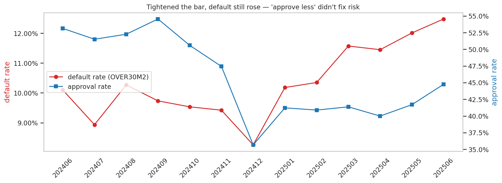
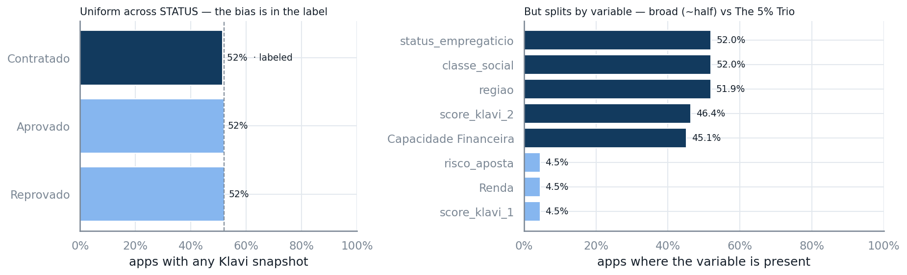
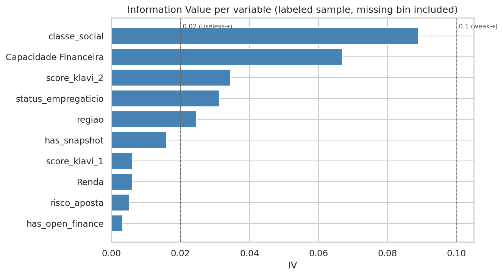
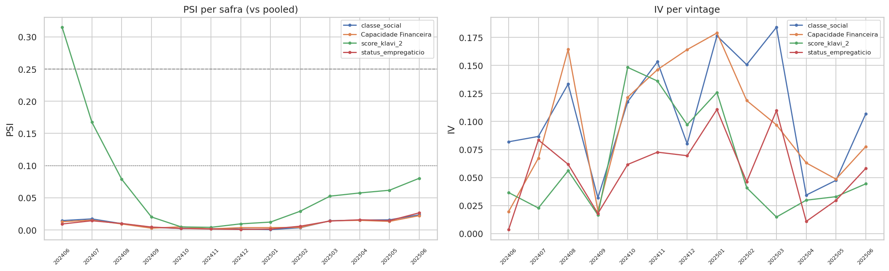
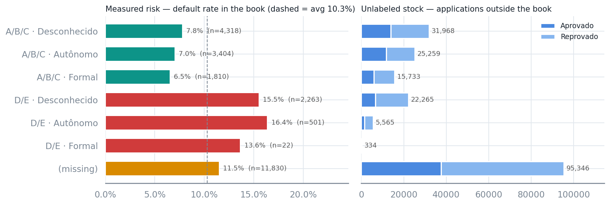
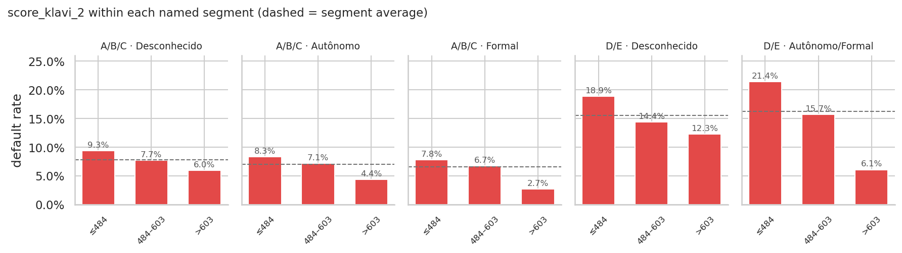
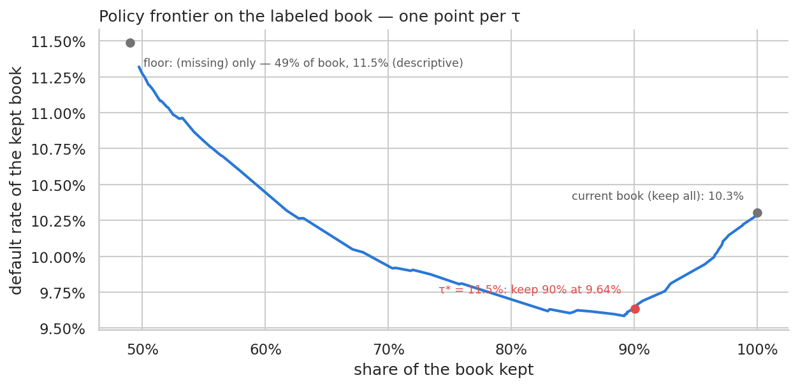
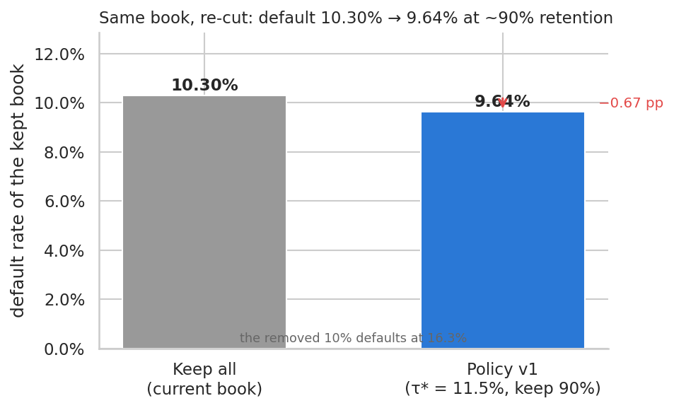
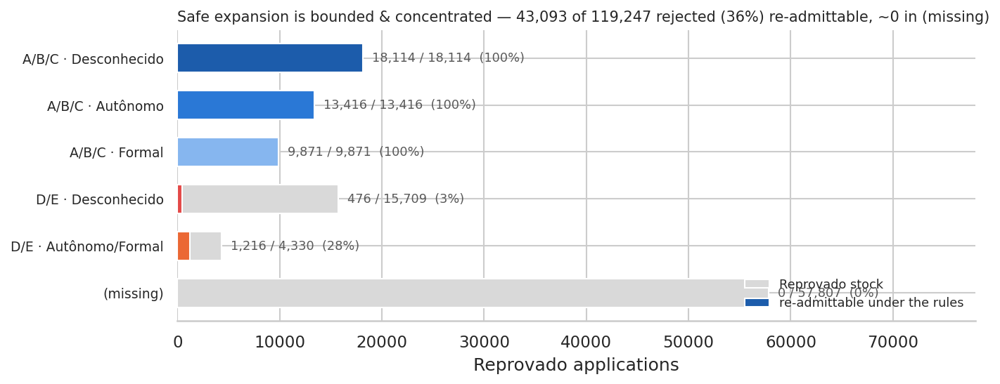

# Presentation Outline — Credit-Granting Policy Review

Slide-by-slide structure for the business-team deck, synthesized from the faithful baseline
[`key_takeaways.md`](key_takeaways.md), the concluded answers in
[`docs/case-scenario.md`](../docs/case-scenario.md) §"Answers", and the notebooks (`notebooks/`).

**How to use this file.** One section per slide: **Key message** (the single line the slide must
land), **Bullets** (supporting points, numbers taken verbatim from `key_takeaways.md`), and the
**Figure** (embedded below each slide, with its source notebook). All 9 figures are exported to
`reports/figures/` (saved in-notebook via `credit_policy.save_fig`; re-run the source notebook to
refresh one). Assemble the deck against this outline; keep numbers reconciled with
`key_takeaways.md`.

Storyline: *why now → the data & its catch → Q1 variables → validation → policy & risk tiers →
score axis → trade-off & impact → safe expansion → validation.*

---

## Slide 1 — Title

**Key message:** Reviewing the Fintech's credit-granting policy — using Klavi's variables to
improve risk assessment.

- Senior Data Scientist @ Klavi; one-week analysis of client-provided data.
- Deliverable: which variables predict default, which are policy candidates, and an objective,
  justifiable proposal.
- Author: Daniel Noce da Silva

*Figure: none (title).*

---

## Slide 2 — Why now

**Key message:** The bar was tightened and default *still* rose — the current process responds by
approving less; we propose to improve how risk is assessed.

- Default (`OVER30M2`) climbed from ~8–10% (2024 cohorts) to **12.5%** (Jun/2025).
- Approval rate fell ~**54% → ~40%** over the same window.
- Tightening didn't reverse the deterioration → the policy needs re-cutting, not just narrowing.

**Figure** — `fig_deterioration_default_vs_approval.png` · nb 1.0 (dual time series: default rate ↑
vs approval rate ↓ by vintage).

---

## Slide 3 — The data & the catch

**Key message:** Two raw files reconciled to one row per application — and only a labeled
slice has performance (selection bias).

- Target `OVER30M2` exists **only for 24,148 `Contratado`** (10.30% default) → selection bias
- Only **52%** of applications carry a feature snapshot at decision time, uniform across `STATUS`
  (availability doesn't differ by outcome); broad vars miss ~54%, open-finance trio ~95%.

**Figure** — `fig_coverage_by_status.png` · nb 1.0 (snapshot coverage by STATUS, showing symmetry;
the labeled 24,148 `Contratado` slice highlighted).

---

## Slide 4 — Q1: Which variables predict default

**Key message:** No single variable discriminates strongly — the policy must **combine
complementary variables**, not lean on one score.

- IV ranking (modest across the board, none reaches "medium" 0.1): `classe_social` **0.089** >
  `Capacidade Financeira` 0.067 > `score_klavi_2` 0.034 > `status_empregaticio` 0.031 >
  `regiao` 0.025.
- Open-finance trio (`score_klavi_1`/`Renda`/`risco_aposta`) scores ~0 — because of **95.5%
  missingness**, not intrinsic weakness.

**Figure** — `fig_iv_ranking.png` · nb 2.1 (horizontal IV bar ranking; 0.1 "medium" threshold
marked; the open-finance trio near zero from missingness).

---

## Slide 5 — Validating the shortlist

**Key message:** The four candidates survive redundancy, stability, leakage, and fairness checks —
we trust them before building on them.

- **Redundancy:** all pairs |r| < 0.5 (max `classe_social` × `Capacidade Financeira` 0.39; the
  naive 0.73 is a co-missingness artifact) → socioeconomic + financial blocks, complementary.
- **Stability:** three of four rock-solid (PSI ≈ 0.02–0.03 across 13 vintages); `score_klavi_2`
  the exception (PSI **0.31** in one safra), bins coarsened to 3 monotone, kept with a **"watch"** flag.
- **Leakage:** none — all weak-tier, point-in-time snapshots by construction.
- **Fairness:** `regiao` (next by IV) **excluded** as a proxy for protected attributes.

**Figure** — `fig_psi_over_vintage.png` · nb 2.2 (PSI per variable across SAFRA + IV per vintage;
`score_klavi_2` breaches the 0.25 line).

---

## Slide 6 — Q3: A two-tier policy

**Key message:** A two-tier policy: segment by the stable socioeconomic block — which orders
cleanly into three risk tiers (2.4× spread) — then score-cut within each named cell.

- **Tier 1 — Segment:** `classe_social` × `status_empregaticio` — 5 named cells + `(missing)`.
- **Tier 2 — Score cut** (`score_klavi_2`) *within* each named cell.
- **Three clean risk tiers** (the ordering that justifies segmenting first): A/B/C **6.5–7.8%** ·
  `(missing)` **11.5%** · D/E **15.5–16.4%** (2.4× spread).
- **`(missing)` = 49% of the book** carries no snapshot → an **11.5% fixed floor**; the score cut
  works only on the ~51% Klavi can see.
- **Fixes today's misorder:** the current bar approves `A/B/C · Formal` (safest, 6.5%) *less*
  (**43.7%**) than a riskier A/B/C cell (50.1% at 7.8%). *(`D/E · Formal`, 22 labeled, merged into
  `D/E · Autônomo/Formal`.)*

**Figure** — `fig_segment_risk_tiers.png` · nb 3.0 (measured default rate by segment vs the
unlabeled stock outside the book).

---

## Slide 7 — Score orders risk inside a segment

**Key message:** A score cut is more precise *and* fairer than denying a whole cell.

- `score_klavi_2` orders risk **end-to-end in all 5 named cells**; steepest in
  `D/E · Autônomo/Formal` (**21.4% → 6.1%**).
- Scoreless applicants inside a named cell default at that cell's baseline (no adverse selection).

**Figure** — `fig_score_within_segment.png` · nb 3.1 (default rate by score bin within each named
segment; steepest gradient in `D/E · Autônomo/Formal`).

---

## Slide 8 — Trade-off & impact

**Key message:** At the same ~90% retention, default drops **10.30% → 9.64%** — measured on the
same book using the same risk-tolerance τ per segment.

- **Operating point τ\* = 11.5%** on named segments — the defensible point on the τ-swept
  approval × default frontier *(left figure)*.
- Rules: A/B/C no score gate; D/E score ≥ 595 / ≥ 518, scoreless denied; `(missing)` deferred.
- The removed 10% defaults at **16.3%** *(right figure)*.
- Gain comes from re-cutting the ~51% named segments (kept at ~7.4%); the 49% `(missing)` floor
  passes through at 11.5%, holding the blend at 9.64% rather than lower.

**Figures** — `fig_tradeoff_frontier.png` · nb 3.2 (retention × default frontier, one point per τ;
τ\* = 11.5% and the `(missing)` floor marked) and `fig_swapset_impact.png` · nb 3.2 (keep-all vs
policy v1 on the same 24,148 rows: default 10.30% → 9.64% at ~90% retention).

---

## Slide 9 — Safe expansion under selection bias

**Key message:** Lending to today's rejected is a *hypothesis* — bounded, concentrated, and tested
in stages.

- Of ~119k rejected, the rules would re-admit **~43k (36%)** — almost all **A/B/C** (no score gate,
  expected ~7.4%), only top-score slivers of D/E, **none of `(missing)`**.
- Klavi refines where it has signal and **respects the client** where it doesn't (the `(missing)`
  block keeps the client's own decision).
- Adopt the cuts already in current intake (a measured effect); expand only via a **staged,
  monitored test** — which also generates the labels missing today.

**Figure** — `fig_expansion_by_segment.png` · nb 3.2 (re-admittable `Reprovado` volume by segment:
A/B/C concentration, D/E slivers, `(missing)` excluded — 43,093 of 119,247, 36%).

---

## Slide 10 — Validation & next steps

**Key message:** Every claim is validated on observed performance; the rollout is designed to be
safe and self-improving.

- **Stability** — segment risk ordering sign-consistent cohort by cohort (74/78 cells).
- **Two-level validation** — segment baseline ordering first, then score confirmed monotone within
  each named segment before trusting it as the cutoff axis.
- **Counterfactual impact** — swap-set + approval × default trade-off on the labeled book.
- **Rollout** — adopt measured cuts now; stage expansion behind a monitored test that produces the
  missing labels. Next structural lever: convert `(missing)` into named cells (more snapshots /
  open-finance consent).

*Figure: none (summary).*
