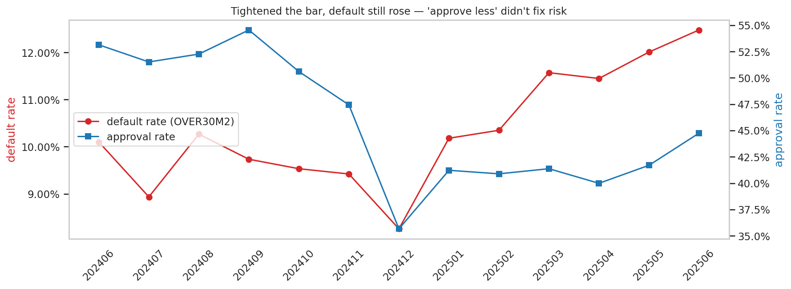
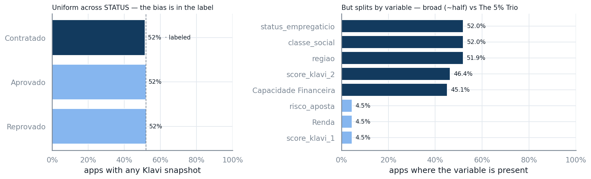
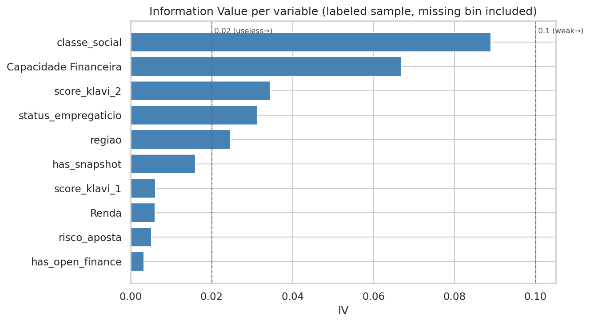
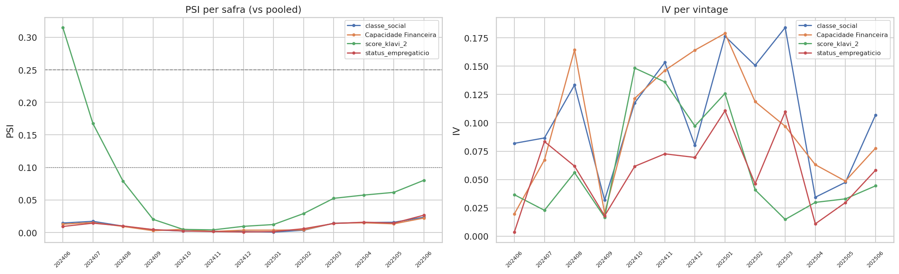
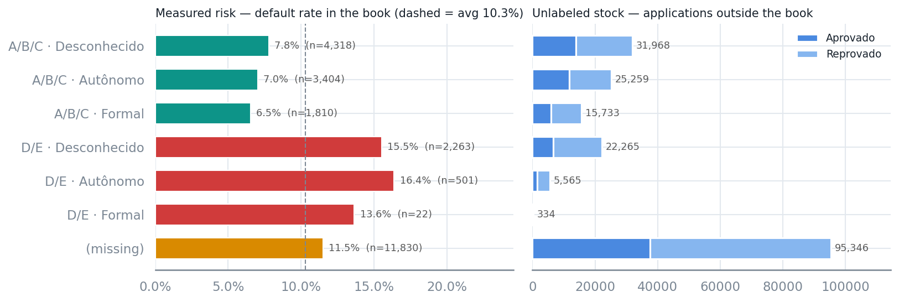
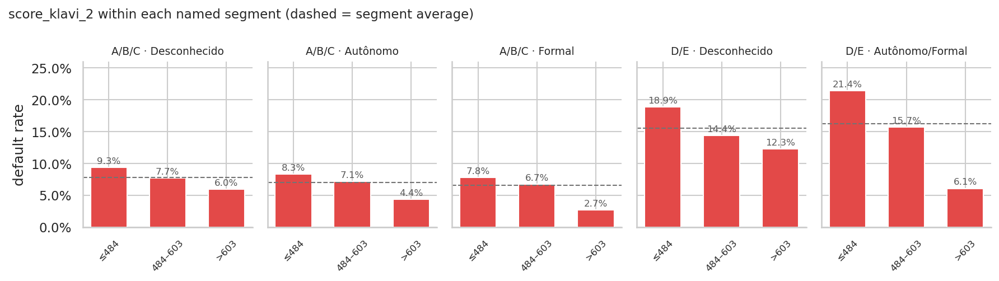
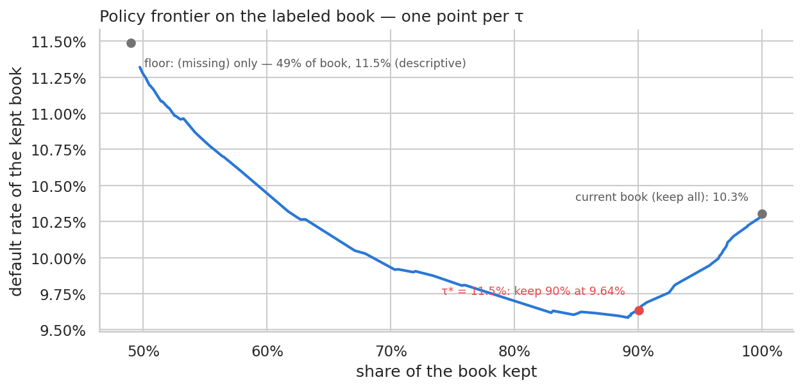
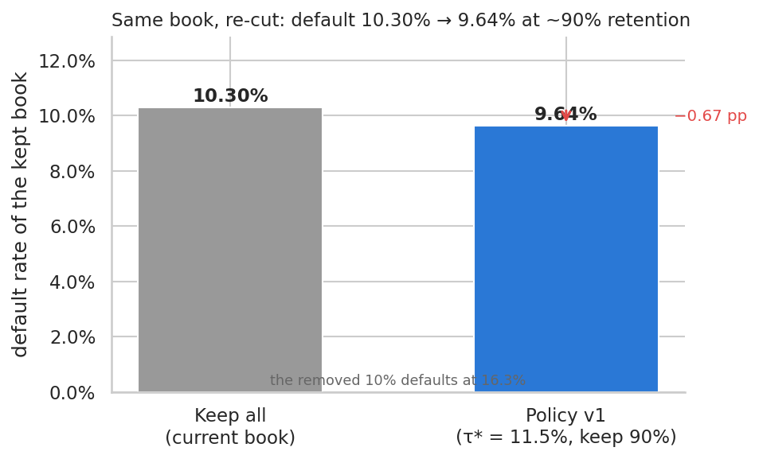
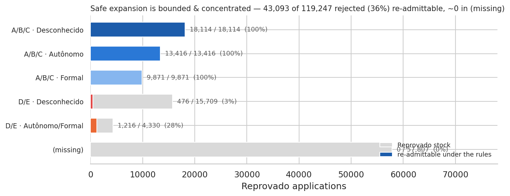

<!-- _class: title -->
<!-- _paginate: false -->

# Credit-Granting Policy Review

Using Klavi's variables to improve risk assessment

Daniel Noce da Silva — Senior Data Scientist @ Klavi 
One-week analysis of client-provided data 
Deliverable: which variables predict default, which are policy candidates, and an objective proposal

---

## Why now

> The bar was tightened and default *still* rose — the current process responds by approving less; we propose to **improve how risk is assessed**.

- Default (`OVER30M2`) climbed from ~**8–10%** (2024 cohorts) to **12.5%** (Jun/2025).
- Approval rate fell from ~**54%** to ~**40%** over the same window.
- The two moved the wrong way together: approvals tightened while default rose.

---

## The data & the catch

> Two raw files reconciled to one row per application — and only a labeled slice has performance (**selection bias**).

- The target `OVER30M2` exists **only for the 24,148 `Contratado`** applications (**10.30%** default) — the one slice we can measure.
- A feature snapshot is present at decision time for only **52%** of applications, evenly across `STATUS`. Coverage splits in two: broad variables miss ~**54%**, the open-finance trio ~**95%**.

---

## Q1 — Which variables predict default

> No single variable discriminates strongly — the policy must **combine complementary variables**, not lean on one score.

- No variable reaches the **0.1** "medium" IV threshold: `classe_social` **0.089** > `Capacidade Financeira` **0.067** > `score_klavi_2` **0.034** > `status_empregaticio` **0.031** > `regiao` **0.025**.
- The open-finance trio (`score_klavi_1` / `Renda` / `risco_aposta`) scores near **0**, driven by **95.5%** missingness.

---

<!-- _class: dense -->

## Validating the shortlist

> All four candidates pass the redundancy, stability, leakage, and fairness checks.

- **Redundancy** — every pair correlates below **|r| 0.5** (max **0.39**, `classe_social` × `Capacidade Financeira`), splitting into a socioeconomic block and a financial block. *(A naive **0.73** between those two is a missing-data artifact.)*
- **Stability** — three are steady across **13** vintages (PSI **0.02–0.03**); `score_klavi_2` drifts once (PSI **0.31**), its bins coarsened to 3 monotone.
- **Leakage** — none; every candidate is a weak, point-in-time signal.
- **Fairness** — `regiao` carries signal but is excluded as a proxy for protected attributes.

---

<!-- _class: dense -->

## Q3 — A two-tier policy

> Segment by the stable socioeconomic block — which orders cleanly into three risk tiers (**2.4×** spread) — then score-cut within each named cell.

- **Tier 1 — Segment** by `classe_social` × `status_empregaticio`: **5** named cells + `(missing)`.
- **Tier 2 — Score cut** on `score_klavi_2` *within* each named cell.
- The named cells fall into three risk tiers: A/B/C **6.5–7.8%** · `(missing)` **11.5%** · D/E **15.5–16.4%** (**2.4×** spread).
- `(missing)` is **49%** of the book and carries no snapshot, so it sits at a fixed **11.5%** floor; the score cut reaches only the ~**51%** Klavi can see.
- Today's bar misorders risk: `A/B/C · Formal` (safest, **6.5%**) is approved **43.7%** — less than a riskier A/B/C cell at **50.1%** (**7.8%**).

---

## Score orders risk inside a segment

> A score cut is more precise *and* fairer than denying a whole cell.

- `score_klavi_2` orders risk **end-to-end in all 5 named cells**; steepest in `D/E · Autônomo/Formal` (**21.4% → 6.1%**).
- Scoreless applicants inside a named cell default at that cell's own baseline.

---

<!-- _class: dense -->

## Trade-off & impact

> At the same ~**90%** retention, default drops **10.30% → 9.64%** — measured on the same book using the same risk-tolerance **τ** per segment.

- **Operating point τ\* = 11.5%** on the named segments, read off the τ-swept approval × default frontier *(left)*.
- Rules: A/B/C no score gate; D/E score ≥ **595** / ≥ **518**, scoreless denied; `(missing)` deferred.
- The removed **10%** defaults at **16.3%** *(right)*.
- The gain comes from re-cutting the ~**51%** named segments (now ~**7.4%**); the **49%** `(missing)` floor passes through unchanged at **11.5%**.

---

<!-- _class: dense -->

## Safe expansion under selection bias

> Lending to today's rejected is a *hypothesis* — bounded, concentrated, and tested in stages.

- Of ~**119k** rejected, the rules would re-admit ~**43k** (**36%**): almost all **A/B/C** (no score gate, ~**7.4%** expected), only top-score slivers of D/E, and none of `(missing)`.
- The `(missing)` block stays with the client's own decision, since Klavi has no snapshot there.
- The cuts already run in current intake (a measured effect); any expansion goes through a **staged, monitored test** that also generates today's missing labels.

